# TeamBoard

**Live demo:** [teamboard-showcase.pingappslab.workers.dev](https://teamboard-showcase.pingappslab.workers.dev) (Cloudflare Workers + D1). Demo login: `demo@teamboard.dev` / `demo1234`. The demo data is shared and reset from time to time.

A multi-user task and project tracker: sign up, create projects, invite teammates, and move tasks across a Kanban board or work through them in a filtered list.

Built by Ramiz Raja as a small but complete example of full-stack TypeScript: Next.js App Router, a domain and service layer behind repository interfaces, server-side permissions, SQL through Drizzle, tests at three levels and CI.

## Features

- Email and password accounts. Sessions are random tokens in an httpOnly cookie, and only a SHA-256 hash of each token is stored.
- Projects with two roles. Owners manage members and delete tasks. Members create and edit tasks. Every check runs on the server.
- Tasks with status, assignee and due date. A Kanban board (drag and drop, or a "Move" select on each card for touch and keyboard) and a list view with search, assignee and status filters and pagination.
- Optimistic updates: moves, edits and deletes show at once and roll back if the server refuses.
- Input validated with zod at the boundary. The same schemas back the forms, server actions and the JSON API.
- Login rate limiting per IP and per email, with a constant-time login path. See [Security](#security).
- Light and dark theme following the system. Works at phone width.
- Seed data with a demo login and two projects.

## Screenshots

Desktop (1280px) and mobile (390px), captured by Playwright from the seeded demo (`e2e/screenshots.spec.ts`).

| Board                                                            | List                                                            | Projects                                                            | Sign in                                                          |
| ---------------------------------------------------------------- | --------------------------------------------------------------- | ------------------------------------------------------------------- | ---------------------------------------------------------------- |
| 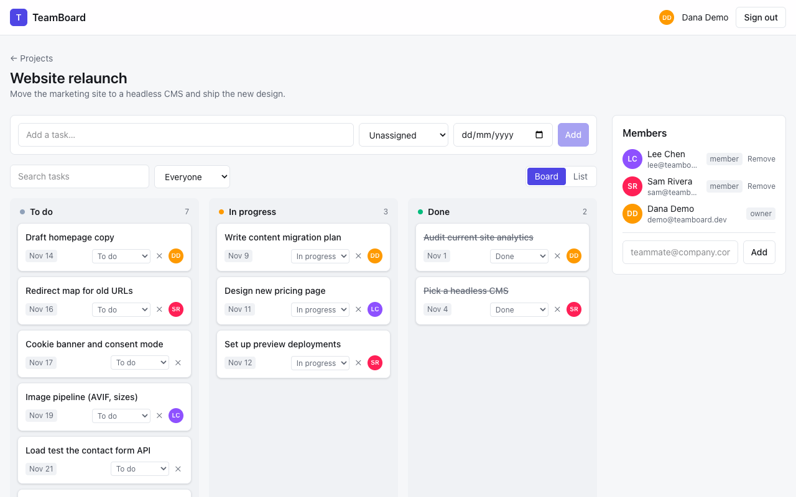 | 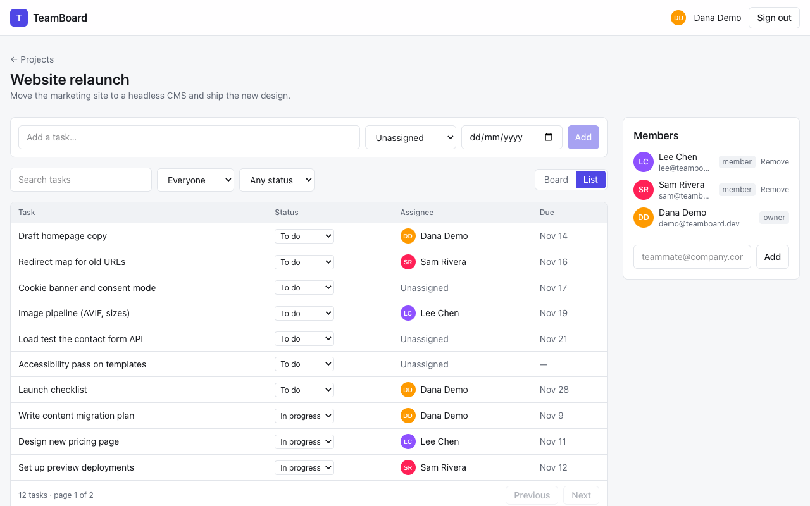 | 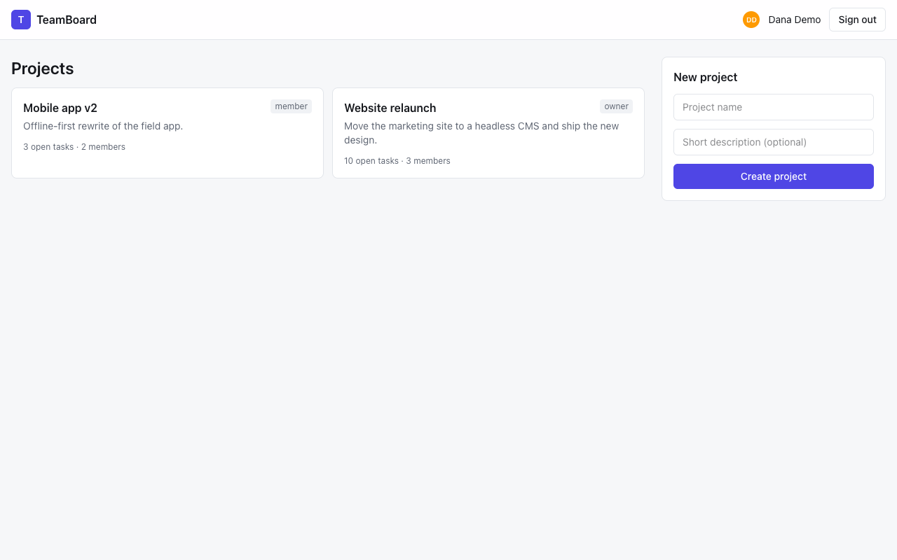 | 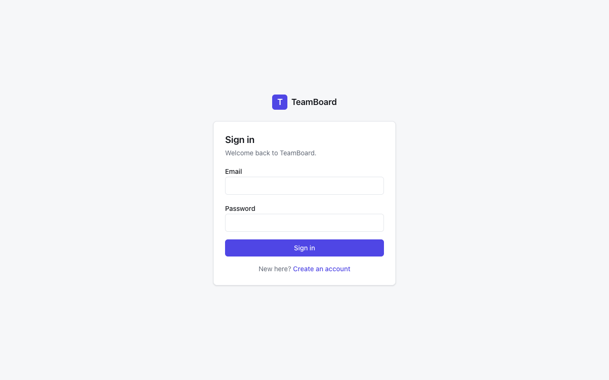 |
| 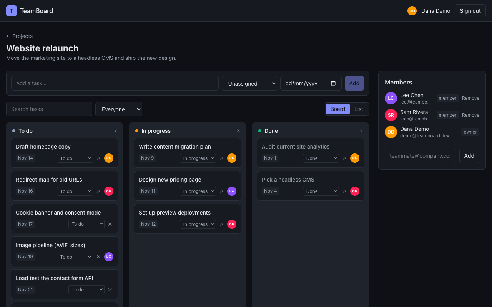  | 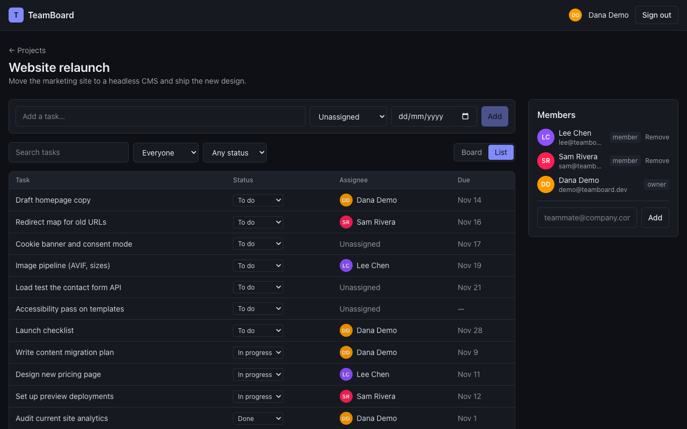  | 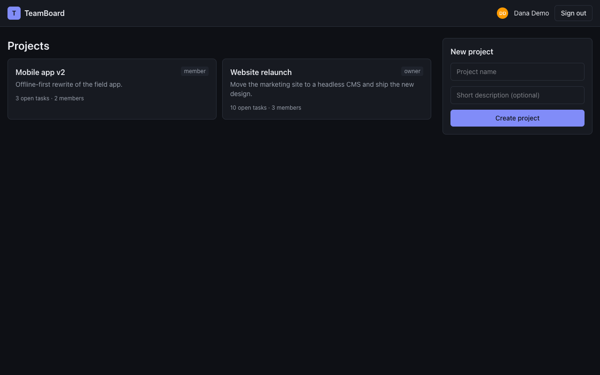  |                                                                  |

| Board (mobile)                                                  | List (mobile)                                                  | Board (mobile, dark)                                           | List (mobile, dark)                                           |
| --------------------------------------------------------------- | -------------------------------------------------------------- | -------------------------------------------------------------- | ------------------------------------------------------------- |
| 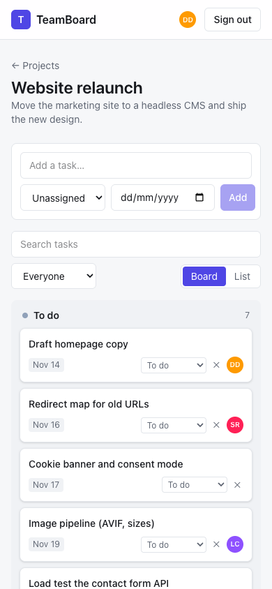 | 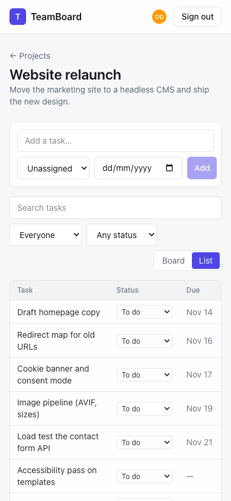 | 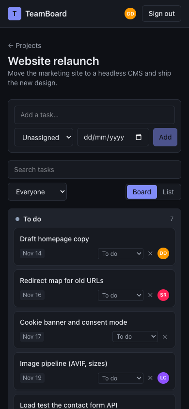 | 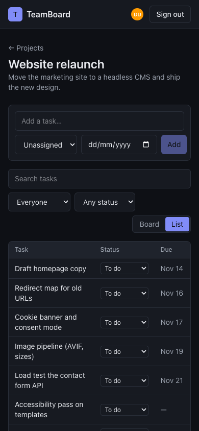 |

## Architecture

**Feature folders, clean layers:** UI and transport (pages, server actions, route handlers) → services (domain rules, permissions) → repository interfaces → Drizzle repositories → SQLite or D1.

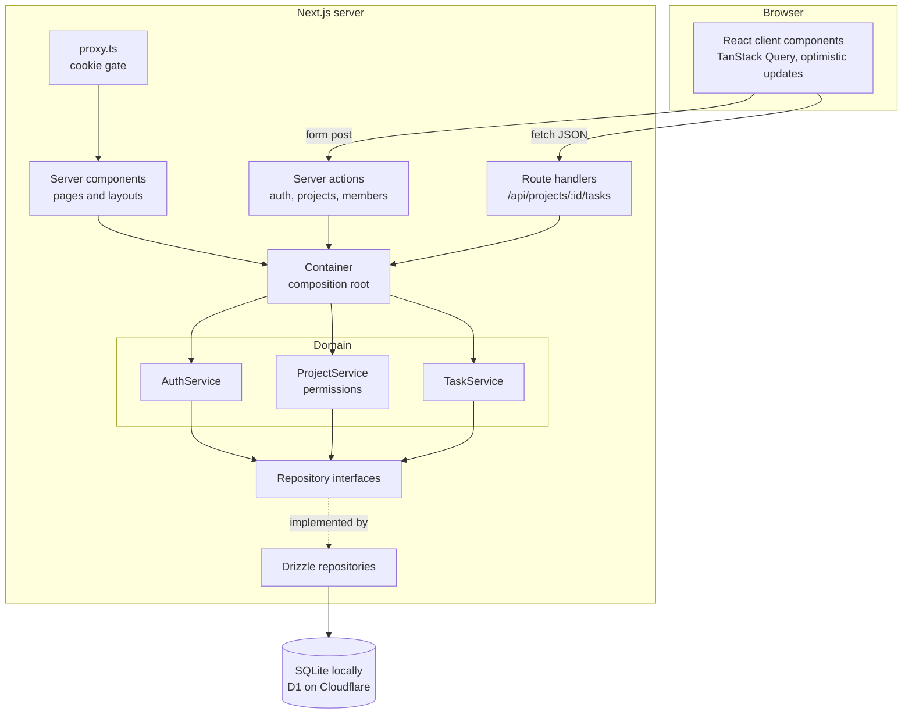

Services never import Drizzle, Next or `Request`. They take plain input, validate it with zod, check permissions and call repositories. Server actions and route handlers are thin: read the session, call one service method, map an `AppError` to a status code or form state. That keeps the rules testable without a server and lets the database change without touching them.

### Folder map

```
src/
  app/                        routes: (auth) login and register, projects, project board, /api JSON routes
  proxy.ts                    redirects to /login when there is no session cookie (the real check is server-side)
  core/                       AppError and status mapping, zod parsing helper, in-memory rate limiter
  db/                         Drizzle schema, SQLite connection, demo seed (local file and SQL for D1)
  server/                     container (composition root), runtime singleton, route-handler and action helpers
  features/
    auth/
      domain/                 AuthService, PBKDF2 hasher, token helpers, schemas, repository interfaces
      data/                   Drizzle user and session repositories
      server/                 server actions, session cookie, current-user lookup
      ui/                     sign-in and register form
    projects/
      domain/                 ProjectService, permissions (the one owner/member table), schemas
      data/                   Drizzle project repository
      server/ ui/             create project and member server actions, forms, members panel
    tasks/
      domain/                 TaskService (positions, filters, assignee rules), schemas
      data/                   Drizzle task repository (search, filters, pagination in SQL)
      ui/                     API client, query hooks, board, card, list, workspace
  components/                 Field, FormError, Avatar
drizzle/                      SQL migrations (also used as the D1 migrations folder)
tests/
  unit/                       services with in-memory fakes, rate limiter, crypto, permissions, action state
  integration/                services plus real Drizzle repositories on in-memory SQLite, route handlers
e2e/                          Playwright: board flow, wrong-password flow, README screenshots
```

### Data flow

1. Pages are server components. They read the session cookie, ask the container for a service and render. A missing project or no access gives the same 404, so project IDs can't be probed.
2. Forms (sign in, register, create project, members) post to server actions. Actions return form state with field errors, or redirect.
3. The board talks to `/api/projects/:id/tasks` through TanStack Query. A move updates every cached task list at once, sends a PATCH, and restores the snapshot if it fails. Lists refetch when the request settles.
4. `TaskService` checks the caller's role, validates that an assignee is a project member, and puts a moved task at the end of its new column (fractional `position`, so no renumbering).
5. Filters, search (escaped `LIKE`, so `%` is literal) and pagination run in SQL, not in memory.

### Why this stack

- **Next.js App Router.** One codebase for pages, server actions and a JSON API, with server components doing the data reads. `cacheComponents` is off because every page is per-user and dynamic, and it keeps the app compatible with the OpenNext Cloudflare adapter.
- **Drizzle.** Typed SQL with no runtime engine. The same schema and queries run on `better-sqlite3` locally and on Cloudflare D1, which is SQLite too. Repositories accept either driver (`BaseSQLiteDatabase<"sync" | "async">`).
- **SQLite and D1, not Postgres.** The app's data is small and relational, D1 is free at this scale on an existing Cloudflare account, and local dev needs no database server. The cost: D1 has no interactive transactions, so writes are single statements and ordering uses fractional positions. Postgres (Neon, Supabase) would be the move for heavy write concurrency.
- **TanStack Query for the board.** Caching, refetch, cancellation and optimistic updates with rollback are solved there. One `useOptimistic` helper is shared by move, edit and delete.
- **PBKDF2 through Web Crypto.** It runs unchanged in Node and in Workers. bcrypt and argon2 need native or WASM builds that Workers handle poorly.
- **Tailwind v4.** Theme as CSS variables, dark mode from `prefers-color-scheme`, a few `@utility` classes for inputs, buttons and cards.

## Run

Requires Node 22+.

```bash
npm install
npm run db:seed       # creates ./data/teamboard.db with the demo data
npm run dev           # http://localhost:3000
```

Sign in with `demo@teamboard.dev` / `demo1234`. The seed also creates `sam@teamboard.dev` and `lee@teamboard.dev` with the same password, so you can see the member role.

## Test

```bash
npm run lint          # typescript-eslint strictTypeChecked
npm run format:check
npm run typecheck
npm run test:coverage
npm run build
npm run test:e2e      # builds must exist; starts next on :3100 with a fresh seeded database
```

54 Vitest tests:

- **Unit tests** run the services against in-memory fakes: auth (timing-safe login, both rate limits, the full-store cases, session expiry and renewal), permissions, the rate limiter, crypto and action-state mapping.
- **Integration tests** run the services and route handlers against real Drizzle repositories on in-memory SQLite. They cover ordering, filters, search escaping, pagination, assignee rules, owner-only deletes, outsiders getting 404, cross-project isolation and HTTP status mapping.

Coverage over `src/core`, the feature `domain` and `data` folders and `src/server` is 97.8% lines, 96.9% statements, 96.8% functions and 93.3% branches. `vitest.config.ts` enforces 85% lines, statements and functions and 80% branches. Not covered by Vitest: React components and server actions. The Playwright flow covers those.

Playwright (`e2e/board.spec.ts`) signs in as the demo user, opens a project, adds a task, drags it to In progress, moves it to Done with the select, reloads and checks that it stayed there. A second test checks the generic wrong-password message. CI installs Chromium. Locally, `PW_CHANNEL=chrome` uses the installed Chrome instead.

Screenshots: `SCREENSHOTS=1 npx playwright test screenshots`.

CI (`.github/workflows/ci.yml`) runs lint, format check, typecheck, tests with coverage, build and the E2E on every push to main and every PR.

## Security

- **Passwords:** PBKDF2-SHA256, 100k iterations, random salt per user, constant-time compare.
- **Sessions:** 256-bit random token in an httpOnly, `SameSite=Lax` cookie (`Secure` in production). The database stores only its SHA-256 hash, so a leaked database can't be used to sign in. 30-day lifetime, extended when less than half is left. Lax cookies plus POST-only mutations are the CSRF defence, and Next server actions also check the Origin header.
- **No account enumeration:** unknown email and wrong password give the same message, and both run one password verify (against a dummy hash for unknown emails), so timing matches. Registration with a taken email gives a neutral message.
- **Rate limiting:** two fixed-window limiters.
  - Per IP, for every login and register attempt: 20 per 15 minutes, checked first.
  - Per email, for failed logins only: 10 per 15 minutes, across all IPs. It is checked before the password verify. While an email is over the limit, every attempt is refused, even with the right password, so a correct guess can't be confirmed. A successful login clears the count.
  - The client IP comes only from `cf-connecting-ip`, which Cloudflare sets and clients can't spoof behind it. `X-Forwarded-For` is never trusted. With no such header (local dev) there is no IP limit.
  - Memory is capped (10,000 keys per limiter). A live window is never evicted. Expired windows are dropped first, and if the store is still full the limiter fails closed: logins that can't be counted are refused.
- **Accepted trade-offs:** anyone can lock an email out for 15 minutes by failing on purpose, and a flood of distinct keys can make the limiter refuse logins until windows expire. A production build would add an unlock link by email or a CAPTCHA (Cloudflare Turnstile) after the limit.
- **Limits of the in-memory limiter:** counts live in one process. On Workers each isolate has its own, so the live demo's limits are per isolate, not global. A production deploy would replace `createMemoryRateLimiter` with Cloudflare's Rate Limiting binding or a Durable Object. The `RateLimiter` interface stays the same.

## Deploy

The live demo runs on Cloudflare Workers through [OpenNext](https://opennext.js.org/cloudflare), with D1 as the database.

- `wrangler.jsonc` binds the D1 database as `DB` (`"migrations_dir": "drizzle"`, so Drizzle's migrations are D1's) and sets `DB_DRIVER=d1`.
- `src/server/runtime.ts` builds the container from `drizzle(getCloudflareContext().env.DB)` when `DB_DRIVER` is `d1`, and from a local SQLite file otherwise. Services and repositories are the same on both; they only use awaited queries, which both drivers support.
- `src/db/seed-sql.ts` seeds an in-memory SQLite database through the services and prints the rows as SQL, since a Node script can't open D1 directly.

```bash
npx wrangler d1 create teamboard-showcase   # once; put the id in wrangler.jsonc
npm run db:migrate:remote                   # apply drizzle/*.sql to D1
npm run db:seed:remote                      # reset D1 to the demo data
npm run preview                             # build and run the worker locally (local D1)
npm run deploy                              # build and deploy to workers.dev
E2E_BASE_URL=https://teamboard-showcase.pingappslab.workers.dev npx playwright test board   # smoke-test the deploy
```

For `npm run preview`, apply migrations and the seed locally first (the same commands with `--local`). `better-sqlite3` is listed in `serverExternalPackages` and is only opened by the local runtime.

## Decisions and trade-offs

- **Route handlers for tasks, server actions for forms.** The board needs a JSON API it can call from TanStack Query with cancellation and optimistic updates. Forms are simpler as server actions with `useActionState` and work before hydration.
- **Permissions in one table.** `can(role, action)` in `features/projects/domain/permissions.ts` is the only place that knows what owners and members may do. Every service method calls it.
- **Outsiders get 404, not 403.** A user who isn't in a project can't tell whether it exists.
- **No transactions.** D1 doesn't support interactive ones, so the code avoids needing them: positions are fractional and every write is one statement.
- **Drag and drop is HTML5 with a select fallback.** No drag library. Touch screens don't fire HTML5 drag events, so each card has a "Move" select, which also covers keyboard users.
- **`proxy.ts` only checks that a cookie exists.** It saves a render for signed-out visitors. The session is validated on every page, action and API call.
- **Fixed-window rate limiting, in memory.** Simple and testable. It is the part a real deploy replaces first (see Security).
- **No email delivery.** Members are added by the email of an existing account. Invites, password reset and email verification would need a mail provider.
