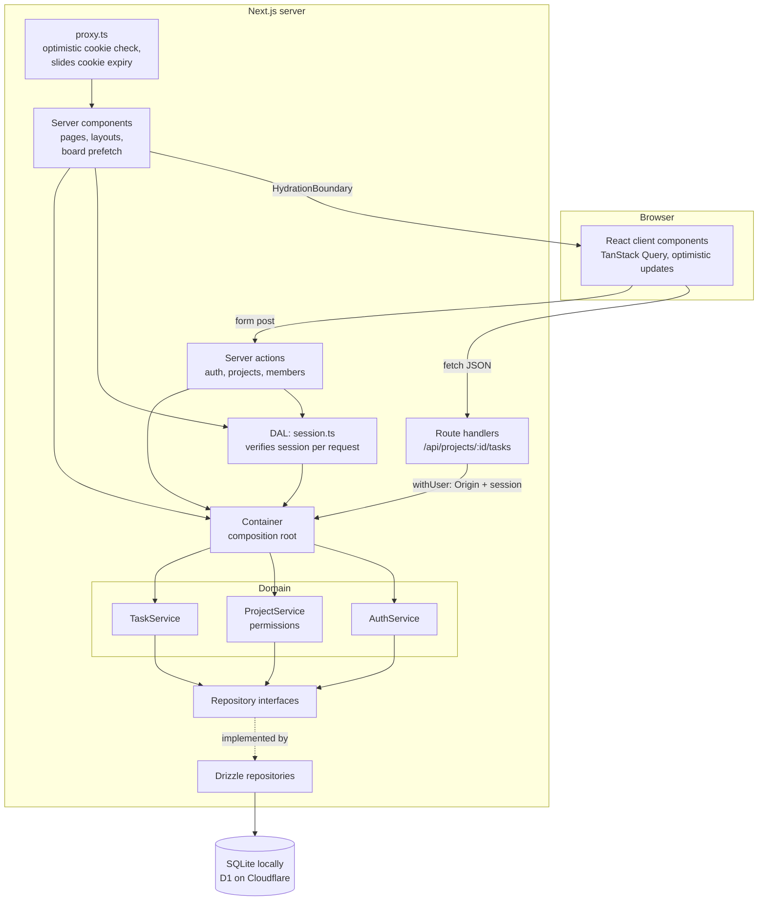
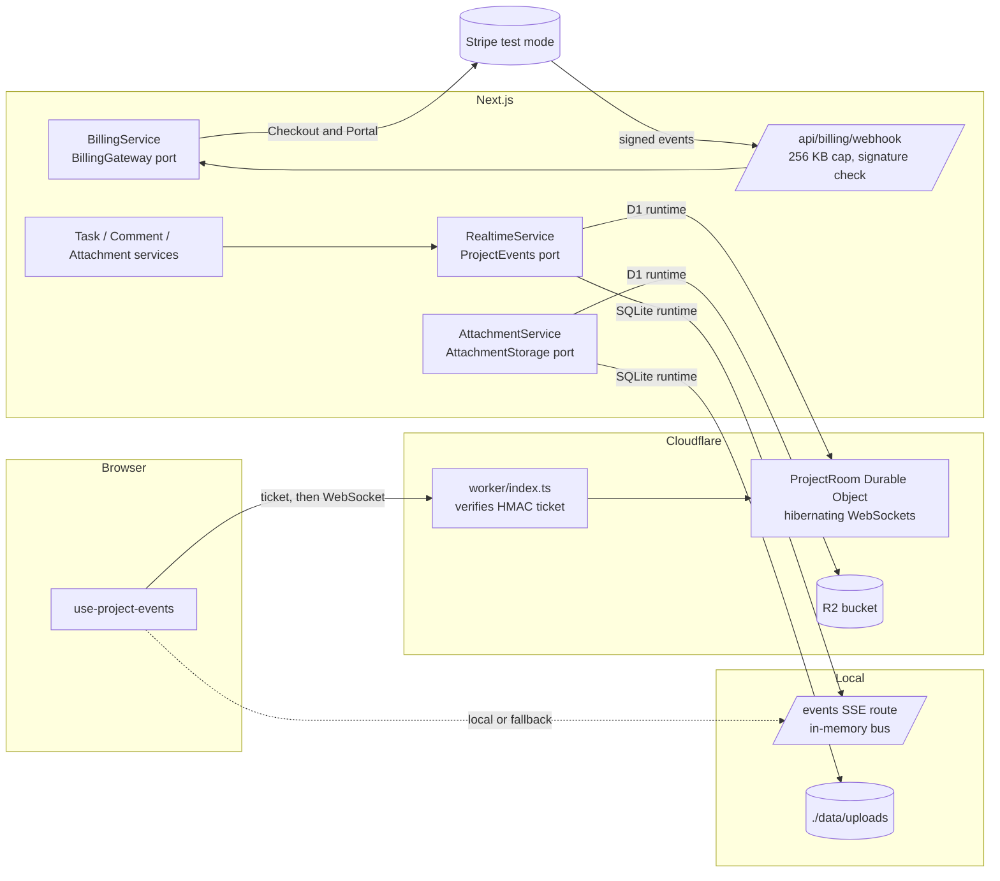

# TeamBoard

A multi-user project and task tracker built with Next.js 16, Drizzle and TanStack Query, following the official Next.js guides for auth, data security and data fetching.

**Live demo:** [teamboard-showcase.pingappslab.workers.dev](https://teamboard-showcase.pingappslab.workers.dev) (Cloudflare Workers + D1). Demo login: `demo@teamboard.dev` / `demo1234`. The demo data is shared and reset from time to time.

Sign up, create projects, invite teammates, and move tasks across a Kanban board or work through them in a filtered list.

Built by Ramiz Raja as a small but complete example of full-stack TypeScript: Next.js App Router, a domain and service layer behind repository interfaces, server-side permissions, SQL through Drizzle, tests at three levels and CI.

## Features

- Email and password accounts. Sessions are random tokens in an httpOnly cookie, and only a SHA-256 hash of each token is stored.
- Projects with two roles. Owners manage members and delete tasks. Members create and edit tasks. Every check runs on the server.
- Tasks with status, assignee and due date. A Kanban board (drag and drop, or a "Move" select on each card for touch and keyboard) and a list view with search, assignee and status filters and pagination.
- Optimistic updates: moves, edits and deletes show at once and roll back if the server refuses.
- Input validated with zod at the boundary. The same schemas back the forms, server actions and the JSON API.
- Login rate limiting per IP and per email, with a constant-time login path. See [Security](#security).
- Light and dark theme following the system. Works at phone width.
- Seed data with a demo login and two projects.
- **Realtime board.** Changes from teammates show up live. On Cloudflare that runs over a Durable Object WebSocket per project. Locally it uses Server-Sent Events. If the socket keeps failing, the client polls every 10 s.
- **Comments and an audit log.** Each task has a comment thread. Every create, edit, move, delete, comment and attachment change is written to an activity log for the project.
- **Attachments.** Upload files to a task (5 MB max, allow-listed types). They are stored in R2 on Cloudflare and on the filesystem locally. If the `ATTACHMENTS` R2 binding is absent (the live demo today, R2 is not enabled there), the feature turns itself off: the task panel shows a notice and the API answers 503.
- **Full-text search** with SQLite FTS5 (prefix matching over title and description). The same migration runs on D1.
- **Stripe billing, test mode only.** Free plan: 3 owned projects, 5 members per project. Pro: unlimited. Covers Checkout, the Customer Portal and a signed webhook. Billing stays hidden until test keys are set.

## Screenshots

Desktop (1280px) and mobile (390px), captured by Playwright from the seeded demo (`e2e/screenshots.spec.ts`).

| Board                                                            | List                                                            | Projects                                                            | Sign in                                                          |
| ---------------------------------------------------------------- | --------------------------------------------------------------- | ------------------------------------------------------------------- | ---------------------------------------------------------------- |
|  |  |  |  |
|   |   |   |                                                                  |

| Board (mobile)                                                  | List (mobile)                                                  | Board (mobile, dark)                                           | List (mobile, dark)                                           |
| --------------------------------------------------------------- | -------------------------------------------------------------- | -------------------------------------------------------------- | ------------------------------------------------------------- |
|  |  |  |  |

## Architecture

**Feature folders, clean layers:** UI and transport (pages, server actions, route handlers) → services (domain rules, permissions) → repository interfaces → Drizzle repositories → SQLite or D1. Everything that reads the session or the database is marked `import "server-only"`, so it can't end up in a client bundle.



Realtime, attachments and billing sit behind ports too. The container picks the adapter for the runtime:



Services never import Drizzle, Next or `Request`. They take plain input, validate it with zod, check permissions and call repositories. Server actions and route handlers are thin: read the session, call one service method, map an `AppError` to a status code or form state. That keeps the rules testable without a server and lets the database change without touching them.

### Folder map

```
src/
  app/                        routes: (auth) login and register, projects, project board, /api JSON routes
  app/error.tsx, not-found.tsx, global-error.tsx, projects/loading.tsx    route boundaries
  proxy.ts                    no cookie: redirect to /login; cookie: slide its expiry (the real check is in the DAL)
  core/                       AppError and status mapping, zod parsing helper, in-memory rate limiter
  db/                         Drizzle schema, SQLite connection, demo seed (local file and SQL for D1)
  server/                     container (composition root), runtime singleton, route-handler and action helpers
  features/
    auth/
      domain/                 AuthService, PBKDF2 hasher, token helpers, schemas, repository interfaces
      data/                   Drizzle user and session repositories
      server/                 server actions, cookie options, DAL (session.ts: getCurrentUser, requireUser)
      ui/                     sign-in and register form
    projects/
      domain/                 ProjectService, permissions (the one owner/member table), schemas
      data/                   Drizzle project repository
      server/ ui/             create project and member server actions, forms, members panel
    tasks/
      domain/                 TaskService (positions, filters, assignee rules), schemas, due-date label
      data/                   Drizzle task repository (FTS5 search, filters, pagination in SQL), FTS query builder
      server/                 server-only board prefetch for HydrationBoundary
      ui/                     API client, query cache contract (queries.ts), hooks, board, card, list, workspace
    realtime/                 ticket (HMAC), RealtimeService, in-memory bus (SSE), Durable Object client, room core, client hook
    comments/ activity/       CommentService, ActivityService (audit log) and their Drizzle repositories
    attachments/              AttachmentService and limits, Drizzle repository, R2, filesystem and in-memory storage
    billing/                  plans and limits, BillingService (webhook idempotency, event ordering), Stripe gateway, billing card
worker/                       Worker entry (OpenNext handler plus the WebSocket upgrade) and the ProjectRoom Durable Object
  components/                 Field, FormError, Avatar
drizzle/                      SQL migrations (also used as the D1 migrations folder)
tests/
  unit/                       services with in-memory fakes, rate limiter, crypto, tickets, room core, FTS query, Stripe gateway
  integration/                services plus real Drizzle repositories on in-memory SQLite, route handlers
e2e/                          Playwright: board, wrong password, realtime across two users, attachments, README screenshots
```

### Data flow

1. Pages are server components. Each one calls the DAL (`requireUser`, memoized per request with React `cache`), asks the container for a service and renders. A missing project or no access gives the same 404, so project IDs can't be probed. The auth check is in every page, not only the layout, because layouts don't re-render on client navigation.
2. Forms (sign in, register, create project, members) post to server actions. Actions return form state with field errors, or redirect.
3. The project page prefetches the unfiltered board on the server and passes it through `HydrationBoundary`, so the first paint already has cards. From then on the board talks to `/api/projects/:id/tasks` through TanStack Query, under the same query keys (`tasks/ui/queries.ts`). A move updates every cached task list at once, sends a PATCH, and restores the snapshot if it fails. Lists refetch when the request settles.
4. `TaskService` checks the caller's role, validates that an assignee is a project member, and puts a moved task at the end of its new column (fractional `position`, so no renumbering).
5. Filters, search and pagination run in SQL, not in memory. Search uses an FTS5 table that triggers keep in sync with `tasks`. User input is turned into quoted prefix terms, so FTS operators in a query are treated as text.
6. After every successful write, the service publishes a small event (`task.created`, `task.moved`, ...) to the project's room. Clients invalidate the affected queries and refetch, so the server stays the single source of truth.

### Why this stack

- **Next.js App Router.** One codebase for pages, server actions and a JSON API, with server components doing the data reads. `cacheComponents` is off because every page is per-user and dynamic, and it keeps the app compatible with the OpenNext Cloudflare adapter.
- **Drizzle.** Typed SQL with no runtime engine. The same schema and queries run on `better-sqlite3` locally and on Cloudflare D1, which is SQLite too. Repositories accept either driver (`BaseSQLiteDatabase<"sync" | "async">`).
- **SQLite and D1, not Postgres.** The app's data is small and relational, D1 is free at this scale on an existing Cloudflare account, and local dev needs no database server. The cost: D1 has no interactive transactions, so writes are single statements and ordering uses fractional positions. Postgres (Neon, Supabase) would be the move for heavy write concurrency.
- **TanStack Query for the board.** Caching, refetch, cancellation and optimistic updates with rollback are solved there. One `useOptimistic` helper is shared by move, edit and delete. Server prefetch plus `HydrationBoundary` follows the Next.js TanStack Query guide.
- **PBKDF2 through Web Crypto.** It runs unchanged in Node and in Workers. bcrypt and argon2 need native or WASM builds that Workers handle poorly.
- **Tailwind v4.** Theme as CSS variables, dark mode from `prefers-color-scheme`, a few `@utility` classes for inputs, buttons and cards.

### Official guidance followed

| Guide                                                                                                                                                               | Where it shows up                                                                                                                                                                                          |
| ------------------------------------------------------------------------------------------------------------------------------------------------------------------- | ---------------------------------------------------------------------------------------------------------------------------------------------------------------------------------------------------------- |
| [Next.js: Project structure](https://nextjs.org/docs/app/getting-started/project-structure)                                                                         | `app/` holds routes only; features live in `src/features/*` (colocation outside `app`)                                                                                                                     |
| [Next.js: Authentication](https://nextjs.org/docs/app/guides/authentication)                                                                                        | DAL in `auth/server/session.ts` with `server-only` and `cache`; proxy does an optimistic cookie check and refreshes the cookie expiry; auth checked in pages, actions and route handlers, not just layouts |
| [Next.js: Data security](https://nextjs.org/docs/app/guides/data-security)                                                                                          | DTOs to client components (`toUser`, member refs), every Server Action re-authenticates, route handlers check Origin on mutations because only Server Actions get that check built in                      |
| [Next.js: Server Actions](https://nextjs.org/docs/app/guides/server-actions) and [Mutating data](https://nextjs.org/docs/app/getting-started/mutating-data)         | Forms use Server Actions with `useActionState` and `revalidatePath`; the board uses route handlers because Server Actions are dispatched one at a time and are not for data fetching                       |
| [Next.js: TanStack Query](https://nextjs.org/docs/app/guides/client-side-data-fetching/tanstack-query)                                                              | QueryClient per server render and one in the browser, server prefetch with `HydrationBoundary`, one shared cache contract, `onMutate` rollback                                                             |
| [Next.js: Error handling](https://nextjs.org/docs/app/getting-started/error-handling)                                                                               | Expected errors are returned as form state or HTTP status; unexpected ones reach `error.tsx` / `global-error.tsx`                                                                                          |
| [Next.js: Proxy](https://nextjs.org/docs/app/getting-started/proxy)                                                                                                 | `src/proxy.ts`, cookie read only, no database                                                                                                                                                              |
| [TanStack Query: Advanced SSR](https://tanstack.com/query/latest/docs/framework/react/guides/advanced-ssr)                                                          | `getQueryClient` pattern and `staleTime` above zero so hydrated data is not refetched at once                                                                                                              |
| [Drizzle ORM](https://orm.drizzle.team/docs/overview)                                                                                                               | One schema for better-sqlite3 and D1, migrations from `drizzle-kit generate`, reused as D1 migrations                                                                                                      |
| [Cloudflare: Durable Objects WebSockets](https://developers.cloudflare.com/durable-objects/best-practices/websockets/)                                              | Hibernation API (`acceptWebSocket`, `webSocketMessage`), one room per project, tickets checked before the upgrade                                                                                          |
| [Cloudflare R2 Workers API](https://developers.cloudflare.com/r2/api/workers/workers-api-reference/)                                                                | `ATTACHMENTS` binding with `put`, `get` and `delete` behind the `AttachmentStorage` port                                                                                                                   |
| [Cloudflare D1 SQL statements](https://developers.cloudflare.com/d1/sql-api/sql-statements/) and [SQLite FTS5](https://www.sqlite.org/fts5.html)                    | `tasks_fts` FTS5 table (a regular, contentful table keyed by `task_id`, not external-content) and triggers in `drizzle/0001_tasks_fts.sql`, the same file locally and on D1                                |
| [Stripe: Webhooks](https://docs.stripe.com/webhooks) and [subscription webhooks](https://docs.stripe.com/billing/subscriptions/webhooks)                            | Raw body verified with `constructEventAsync`, event IDs stored for idempotency, older events ignored, 2xx returned quickly                                                                                 |
| [Stripe: Build subscriptions](https://docs.stripe.com/billing/subscriptions/build-subscriptions) and [Customer portal](https://docs.stripe.com/customer-management) | Checkout Session in `subscription` mode with `client_reference_id`; the portal handles plan changes and cancellation                                                                                       |
| [Stripe: Testing](https://docs.stripe.com/testing) and [Stripe CLI](https://docs.stripe.com/stripe-cli)                                                             | Test keys only, test cards, `stripe listen` for local webhooks; Vitest signs fixtures with `generateTestHeaderString` and never calls Stripe                                                               |
| [typescript-eslint shared configs](https://typescript-eslint.io/users/configs)                                                                                      | `strictTypeChecked` with type information, plus `eslint-config-next`                                                                                                                                       |

## Run

Requires Node 22+.

```bash
npm install
npm run db:seed       # creates ./data/teamboard.db with the demo data
npm run dev           # http://localhost:3000
```

Sign in with `demo@teamboard.dev` / `demo1234`. The seed also creates `sam@teamboard.dev` and `lee@teamboard.dev` with the same password, so you can see the member role. Open the same board as two users in two browsers to see realtime updates.

Optional settings live in `.env.example` (copy it to `.env.local`). To try billing, put Stripe **test-mode** keys there (`sk_test_...`, a `price_...` for a recurring price, and the `whsec_...` that the CLI prints), then run:

```bash
stripe listen --forward-to localhost:3000/api/billing/webhook
```

Pay with the test card `4242 4242 4242 4242`. Without the keys, billing is hidden and every plan limit is off.

## Test

```bash
npm run lint          # typescript-eslint strictTypeChecked
npm run format:check
npm run typecheck
npm run test:coverage
npm run build
npm run test:e2e      # builds must exist; starts next on :3100 with a fresh seeded database
```

178 Vitest tests in 20 files:

- **Unit tests** run the services against in-memory fakes: auth (timing-safe login, both rate limits, the full-store cases, session expiry and renewal), permissions, the rate limiter, crypto, action-state mapping, the Origin check, due-date labels, realtime tickets (signature, expiry, tampering), the Durable Object room logic, the FTS query builder, attachment limits, activity text and the Stripe gateway (signed fixtures, event mapping, request bodies through a fake `fetch`).
- **Integration tests** run the services and route handlers against real Drizzle repositories on in-memory SQLite. They cover ordering, filters, FTS search, pagination, assignee rules, owner-only deletes, outsiders getting 404, cross-project isolation, cross-site requests getting 403, HTTP status mapping, comments and the audit log, attachment upload, download and size limits, realtime events and revocation, and billing (webhook signature, body cap, idempotency, out-of-order events, plan limits, and concurrent creates and invites that can't exceed a limit).

Coverage over `src/core`, the feature `domain` and `data` folders and `src/server` is 99.1% lines, 98.4% statements, 97.7% functions and 94.8% branches. `vitest.config.ts` enforces 85% lines, statements and functions and 80% branches. Vitest does not cover React components or server actions; the Playwright flows do.

Playwright:

- `e2e/board.spec.ts` signs in as the demo user, opens a project, adds a task, drags it to In progress, moves it to Done with the select, reloads and checks that it stayed there. A second test checks the generic wrong-password message.
- `e2e/realtime.spec.ts` opens the same board as `demo` and `sam` in two browser contexts. It waits for the "Live" status, then checks that a task created and moved by one user shows up for the other without a reload.
- `e2e/attachments.spec.ts` uploads a file to a task, downloads it and checks its content, reloads, then deletes it.

CI installs Chromium. Locally, `PW_CHANNEL=chrome` uses the installed Chrome instead. Locally the realtime E2E runs over SSE. The WebSocket path runs only on Cloudflare, and its room logic is covered by unit tests.

Screenshots: `SCREENSHOTS=1 npx playwright test screenshots`.

CI (`.github/workflows/ci.yml`, actions v7) runs typecheck, lint, format check, tests with coverage, build and the E2E on every push to main and every PR. A coverage drop below the thresholds fails the build.

## Security

- **Passwords:** PBKDF2-SHA256, 100k iterations, random salt per user, constant-time compare.
- **Sessions:** 256-bit random token in an httpOnly, `SameSite=Lax` cookie (`Secure` in production). The database stores only its SHA-256 hash, so a leaked database can't be used to sign in. 30-day lifetime: the database row is extended when less than half is left, and the proxy slides the cookie expiry on each page visit, so active users stay signed in.
- **CSRF:** `SameSite=Lax` keeps the cookie off cross-site POST, PATCH and DELETE. On top of that, Next.js compares Origin and Host for Server Actions, and `withUser` in `src/server/http.ts` does the same for the JSON route handlers (403 on a mismatch). Reads are GET-only.
- **Server-only code:** the DAL, the container runtime, the route helpers and the board prefetch import `server-only`, so importing them from a client component fails the build.
- **No account enumeration:** unknown email and wrong password give the same message, and both run one password verify (against a dummy hash for unknown emails), so timing matches. Registration with a taken email gives a neutral message.
- **Rate limiting:** two fixed-window limiters.
  - Per IP, for every login and register attempt: 20 per 15 minutes, checked first.
  - Per email, for failed logins only: 10 per 15 minutes, across all IPs. It is checked before the password verify. While an email is over the limit, every attempt is refused, even with the right password, so a correct guess can't be confirmed. A successful login clears the count.
  - The client IP comes only from `cf-connecting-ip`, which Cloudflare sets and clients can't spoof behind it. `X-Forwarded-For` is never trusted. With no such header (local dev) there is no IP limit.
  - Memory is capped (10,000 keys per limiter). A live window is never evicted. Expired windows are dropped first, and if the store is still full the limiter fails closed: logins that can't be counted are refused.
- **Realtime tickets:** the WebSocket path never sees the session cookie. `/api/projects/:id/realtime` checks the session and membership, then mints a 30 s HMAC ticket (one use, with `jti` and `iat`). The Worker verifies the ticket before it hands the socket to the room. Removing a member stores a cutoff in the room, which drops their sockets and refuses older tickets.
- **Stripe webhook:** a missing or malformed `Stripe-Signature` header is refused before the body is read. The body is read with a 256 KB cap (Content-Length required), then verified against the raw bytes. Event IDs are claimed once, so retries are no-ops. If handling fails, the claim is released so that Stripe's retry can run again.
- **Attachments:** size and type are checked before storage. Keys are server-generated, never taken from the filename. Downloads are sent with `Content-Disposition: attachment` and `X-Content-Type-Options: nosniff`, so an uploaded HTML file can't run on the app's origin.
- **Dependency audit:** `npm audit` reports advisories only in build and dev tooling (glob and minimatch inside `@opennextjs/aws`, esbuild inside `drizzle-kit`, minimatch inside typescript-eslint and eslint plugins). None of it ships in the Worker bundle, and npm's only suggested fixes are downgrades to old majors, so they are left until upstream releases. Runtime dependencies have no advisories.
- **Accepted trade-offs:** anyone can lock an email out for 15 minutes by failing on purpose, and a flood of distinct keys can make the limiter refuse logins until windows expire. A production build would add an unlock link by email or a CAPTCHA (Cloudflare Turnstile) after the limit.
- **Limits of the in-memory limiter:** counts live in one process. On Workers each isolate has its own, so the live demo's limits are per isolate, not global. This is a known limitation, not fixed here: the Workers Rate Limiting binding only supports 10 or 60 second periods, is approximate and per location, and has no reset, so it does not fit the 15 minute windows or the clear-on-success rule. A strict global limit needs a Durable Object counter, and the (currently synchronous) `RateLimiter` interface would have to become async. Both limits are per isolate on the live demo; the PBKDF2 cost per guess is the only limit that holds everywhere.

## Deploy

The live demo runs on Cloudflare Workers through [OpenNext](https://opennext.js.org/cloudflare), with D1 as the database.

- `wrangler.jsonc` binds the D1 database as `DB` (`"migrations_dir": "drizzle"`, so Drizzle's migrations are D1's) and sets `DB_DRIVER=d1`.
- `src/server/runtime.ts` builds the container from `drizzle(getCloudflareContext().env.DB)` when `DB_DRIVER` is `d1`, and from a local SQLite file otherwise. Services and repositories are the same on both; they only use awaited queries, which both drivers support.
- `src/db/seed-sql.ts` seeds an in-memory SQLite database through the services and prints the rows as SQL, since a Node script can't open D1 directly.

```bash
npx wrangler d1 create teamboard-showcase   # once; put the id in wrangler.jsonc
npx wrangler r2 bucket create teamboard-attachments   # once, optional; then uncomment r2_buckets in wrangler.jsonc
npx wrangler secret put REALTIME_SECRET     # random 32+ byte string for ticket HMACs
npx wrangler secret put STRIPE_SECRET_KEY   # optional, test mode: sk_test_...
npx wrangler secret put STRIPE_WEBHOOK_SECRET   # whsec_... of the endpoint below
npx wrangler secret put STRIPE_PRICE_ID     # price_... of a recurring test price
npm run db:migrate:remote                   # apply drizzle/*.sql to D1
npm run db:seed:remote                      # reset D1 to the demo data
npm run preview                             # build and run the worker locally (local D1)
npm run deploy                              # build and deploy; the ProjectRoom DO migration (v1) applies here
E2E_BASE_URL=https://teamboard-showcase.pingappslab.workers.dev npx playwright test board   # smoke-test the deploy
npm run db:seed:remote                      # reset the demo data the smoke test touched
```

For billing, add a test-mode webhook endpoint in the Stripe Dashboard at `https://<your-worker>/api/billing/webhook` for `checkout.session.completed` and `customer.subscription.created`, `.updated` and `.deleted`.

For `npm run preview`, apply migrations and the seed locally first (the same commands with `--local`). `better-sqlite3` is listed in `serverExternalPackages` and is only opened by the local runtime.

## Decisions and trade-offs

- **Route handlers for tasks, server actions for forms.** The board needs GET reads it can cancel and run in parallel with writes, which TanStack Query does over a JSON API. Server Actions are POST-only and dispatched one at a time, and the Next.js docs point data fetching elsewhere. Forms are simpler as server actions with `useActionState` and work before hydration.
- **Permissions in one table.** `can(role, action)` in `features/projects/domain/permissions.ts` is the only place that knows what owners and members may do. Every service method calls it.
- **Outsiders get 404, not 403.** A user who isn't in a project can't tell whether it exists.
- **No transactions.** D1 doesn't support interactive ones, so the code avoids needing them: positions are fractional and every write is one statement.
- **Plan limits are one conditional statement.** `INSERT ... SELECT ... WHERE (SELECT count(*) ...) < :limit` does the count and the insert together, on SQLite and D1, so concurrent requests can't go over a limit. Zero rows inserted means the limit was reached (402). A refused project create deletes the project row it just added.
- **Limits follow the owner's plan.** Members invited to a Pro owner's project don't need Pro themselves.
- **Webhooks: idempotent and ordered by event time.** Stripe can deliver events twice and out of order. Each event ID is claimed once, and an event older than the stored row is ignored. `past_due` keeps Pro while Stripe retries the payment. `canceled`, `unpaid` and `incomplete` fall back to Free.
- **Realtime sends "something changed", not data.** Events carry IDs only, and clients refetch through the normal authorized API. A missed event costs one refetch, not a wrong board.
- **SSE locally, Durable Objects on Cloudflare.** Workers isolates don't share memory, so one Durable Object per project is the meeting point. Hibernating WebSockets keep idle rooms free. Node has one process, so an in-memory bus with SSE is enough there. Polling is the fallback for both.
- **R2 versus filesystem behind one port.** `AttachmentStorage` has `put`, `get` and `delete`. Metadata is in the database, so listing never touches storage. A failed database write after an upload deletes the blob. With no storage configured (`null`) the service reports `enabled: false`.
- **Atomic writes.** A change and its audit row are written in one D1 `batch()` (one implicit transaction, no interactive transactions on D1) or one `better-sqlite3` transaction locally, through `atomically()` in `src/db/atomic.ts`. Either both rows exist or neither. Realtime publishing happens after the commit and is best-effort.
- **Demo entry is a POST.** `POST /api/demo` starts the shared demo session (CSRF-checked, 303 to `/projects`). `GET` returns 405, so prefetchers and crawlers can't create sessions. The landing page and the login page post a form to it.
- **Drag and drop is HTML5 with a select fallback.** No drag library. Touch screens don't fire HTML5 drag events, so each card has a "Move" select, which also covers keyboard users.
- **`proxy.ts` only checks that a cookie exists.** It saves a render for signed-out visitors and refreshes the cookie expiry, but never touches the database. The session is validated in the DAL on every page, action and API call.
- **Shared browser QueryClient.** One client per tab, as the guides recommend. Sign-out clears it before the Server Action redirects, and removing a member invalidates the cached board, so no stale data survives either.
- **Fixed-window rate limiting, in memory.** Simple and testable. It is the part a real deploy replaces first (see Security).
- **No email delivery.** Members are added by the email of an existing account. Invites, password reset and email verification would need a mail provider.
- **Clock skew on revocation.** A revoke stores a cutoff from the Durable Object's clock and the room refuses tickets whose `iat` (from the Next.js isolate's clock) is at or before cutoff + 5 s; skew between Worker isolates beyond that margin could let a ticket issued just before a revocation through within its 30 s lifetime.
